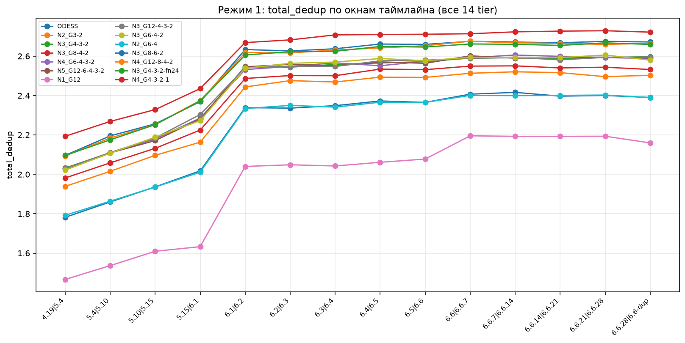
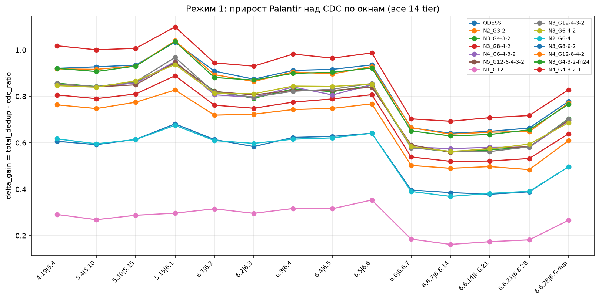
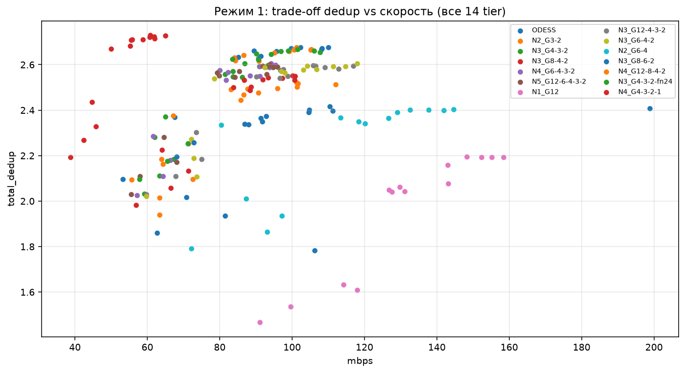
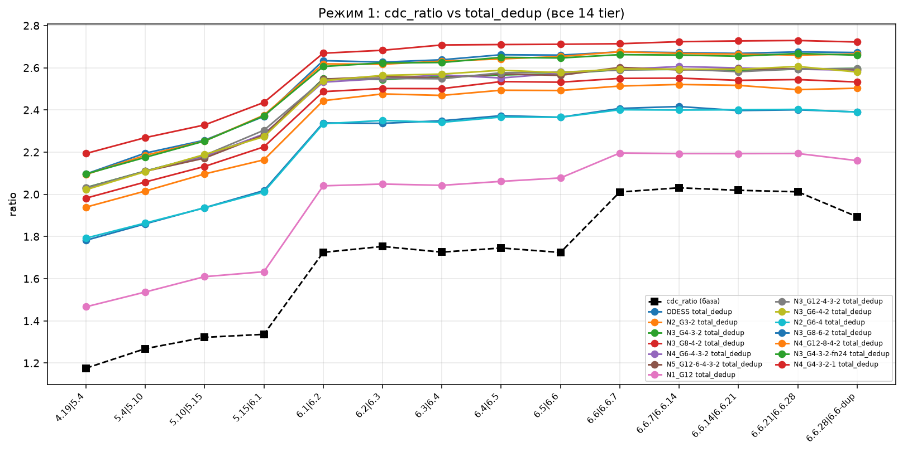
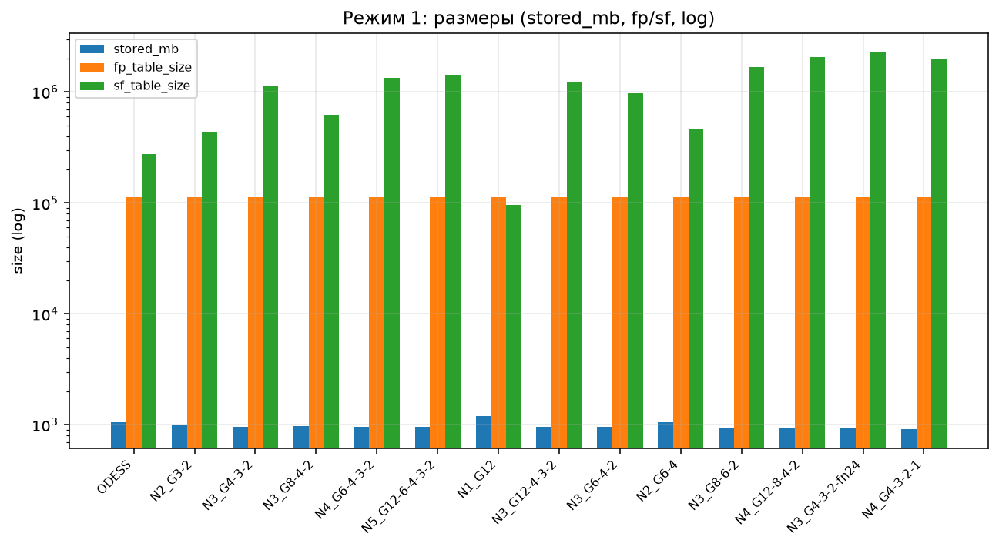
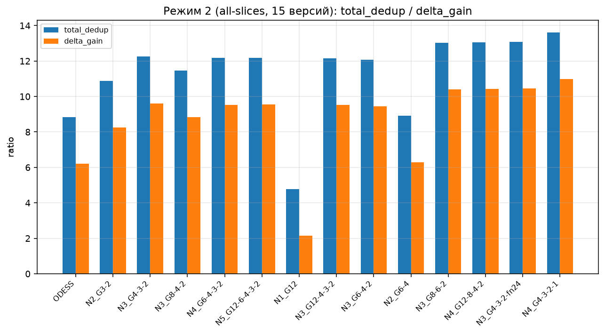

# Kernel-бенчмарки Palantir: tier-конфигурации

Дата: 2026-10-15

## Ключевые выводы

- Цель: прирост Palantir (near-dup дедуп) над базовым CDC и trade-off dedup↔скорость для 14 tier-конфигов на 15 версиях ядра Linux.
- Базовый CDC (`cdc_ratio`) одинаков для всех tier внутри кейса — sanity пройдена.
- Лучший dedup — `N4_G4-3-2-1` (Реж.1 2.595; Реж.2 13.62): тончайший слой (`group_size=1`) даёт **+5.7%** к базе, но −33% скорости (54 МБ/с).
- Лучший компромисс dedup/скорость — `N3_G12-4-3-2` и `N3_G6-4-2`: dedup уровня базы (~2.46) при 93 МБ/с (+15% к базе).
- `N1_G12` — near-exact baseline: максимум скорости (131 МБ/с), минимум dedup (1.96).
- dedup определяют тонкие слои и `features_num`, а не «ширина» top-tier'а; `features_num` 12→24 даёт +2.9% dedup ценой ×2 `sf_table_size`.

## Данные и метод

- Датасет: исходники ядра Linux, 15 версий (LTS-разброс → mainline → stable 6.6.x → exact-дубль).
- Режим 1: 14 перекрывающихся окон по 2 полных дерева (`case` вида `X.Y|Z.W`); 196 запусков = 14 окон × 14 tier (84 старых + 112 новых).
- Режим 2: единый срез по всем версиям в одном таймлайне; 14 строк (14 tier).
- Фиксация: `seed=0`; базовый CDC `SizeParams { min: 8192, avg: 32768, max: 65536 }`.

### Tier-конфигурации (14)

| tier | tier_list | features_num | примечание |
|---|---|---|---|
| `ODESS` | 4 | 12 | one-tier |
| `N2_G3-2` | 3-2 | 6 | |
| `N3_G4-3-2` | 4-3-2 | 12 | база |
| `N3_G8-4-2` | 8-4-2 | 8 | |
| `N4_G6-4-3-2` | 6-4-3-2 | 12 | |
| `N5_G12-6-4-3-2` | 12-6-4-3-2 | 12 | |
| `N1_G12` | 12 | 12 | near-exact |
| `N3_G12-4-3-2` | 12-4-3-2 | 12 | top-tier 12 |
| `N3_G6-4-2` | 6-4-2 | 12 | |
| `N2_G6-4` | 6-4 | 12 | |
| `N3_G8-6-2` | 8-6-2 | 24 | |
| `N4_G12-8-4-2` | 12-8-4-2 | 24 | |
| `N3_G4-3-2-fn24` | 4-3-2 | 24 | features_num override |
| `N4_G4-3-2-1` | 4-3-2-1 | 12 | group_size=1 |

## Среда

- CPU: AMD Ryzen AI 7 PRO 350 (16 CPU); RAM: 11 GiB; ОС: Linux 7.1.3-2-cachyos
- Rust 1.96.1; Python 3.14; Matplotlib 3.11.2

## Режим 1: сводка по tier (усреднение по 14 окнам)

| tier | total_dedup | delta_gain | mbps | stored_mb | sf_table_size |
|---|---|---|---|---|---|
| ODESS | 2.2406 | 0.5448 | 100.1 | 1051.4 | 274033 |
| N2_G3-2 | 2.3670 | 0.6712 | 86.4 | 994.7 | 434984 |
| N3_G4-3-2 | 2.4539 | 0.7582 | 80.9 | 959.2 | 1145202 |
| N3_G8-4-2 | 2.4049 | 0.7092 | 85.0 | 978.8 | 618901 |
| N4_G6-4-3-2 | 2.4536 | 0.7578 | 81.6 | 959.3 | 1330552 |
| N5_G12-6-4-3-2 | 2.4539 | 0.7582 | 81.3 | 959.2 | 1428179 |
| N1_G12 | 1.9607 | 0.2650 | 131.3 | 1206.4 | 96151 |
| N3_G12-4-3-2 | 2.4555 | 0.7598 | 93.3 | 958.5 | 1240594 |
| N3_G6-4-2 | 2.4567 | 0.7610 | 93.0 | 958.1 | 973330 |
| N2_G6-4 | 2.2396 | 0.5438 | 113.9 | 1051.9 | 460942 |
| N3_G8-6-2 | 2.5357 | 0.8399 | 88.7 | 928.2 | 1683137 |
| N4_G12-8-4-2 | 2.5286 | 0.8329 | 86.4 | 930.8 | 2050656 |
| N3_G4-3-2-fn24 | 2.5249 | 0.8292 | 86.8 | 932.1 | 2287788 |
| N4_G4-3-2-1 | 2.5945 | 0.8987 | 54.1 | 907.2 | 1975818 |

## Режим 2: единый срез (15 версий, 1 таймлайн)

`cdc_ratio` = 2.6343 для всех tier.

| tier | total_dedup | delta_gain | mbps | stored_mb |
|---|---|---|---|---|
| ODESS | 8.8406 | 6.2062 | 73.6 | 304.6 |
| N2_G3-2 | 10.8793 | 8.2449 | 69.2 | 247.5 |
| N3_G4-3-2 | 12.2492 | 9.6148 | 67.7 | 219.8 |
| N3_G8-4-2 | 11.4751 | 8.8408 | 70.0 | 234.7 |
| N4_G6-4-3-2 | 12.1714 | 9.5371 | 69.2 | 221.2 |
| N5_G12-6-4-3-2 | 12.1843 | 9.5500 | 68.9 | 221.0 |
| N1_G12 | 4.7863 | 2.1520 | 86.3 | 562.6 |
| N3_G12-4-3-2 | 12.1521 | 9.5177 | 79.3 | 221.6 |
| N3_G6-4-2 | 12.0803 | 9.4460 | 79.3 | 222.9 |
| N2_G6-4 | 8.9121 | 6.2778 | 88.5 | 302.1 |
| N3_G8-6-2 | 13.0335 | 10.3991 | 78.0 | 206.6 |
| N4_G12-8-4-2 | 13.0496 | 10.4152 | 76.9 | 206.3 |
| N3_G4-3-2-fn24 | 13.0773 | 10.4430 | 78.3 | 205.9 |
| N4_G4-3-2-1 | 13.6209 | 10.9866 | 71.2 | 197.7 |

## Разбор новых конфигов

- `N3_G4-3-2` → `N3_G12-4-3-2`: расширение top-tier 4→12 почти не меняет dedup (+0.07%), но даёт **+15% скорости** (81→93 МБ/с). Мелкие слои `4-3-2` определяют dedup, грубый `12` работает как дешёвый префильтр.
- `features_num` 12→24 (`N3_G4-3-2-fn24`): **+2.9% dedup**, но `sf_table_size` ×2. Самый дешёвый способ поднять dedup без роста числа tier'ов.
- `N4_G4-3-2-1` (`group_size=1`): **лучший dedup** (+5.7%), но −33% скорости — верхняя граница качества.
- «Тяжёлые» `features_num=24` (`N3_G8-6-2`, `N4_G12-8-4-2`): 2.53–2.54 при 86–89 МБ/с, как `fn24`, но за счёт большего числа tier'ов.
- `N2_G6-4` (2-tier) — как `ODESS`: двух tier'ов мало, dedup падает до ~2.24.

## Графики

## Шум/детерминизм

- `cdc_ratio` детерминирован и совпадает для всех tier внутри кейса; `total_dedup`/`mbps` колеблются ~0.001 (HashMap + многопоточность) — это не значимо.

## Ограничения

- Охвачены только tier × таймлайн (без `near_dup`, `sampling_rate`, `SearchConfig`).

## Воспроизводимость

- Данные: `materials/kernels/regime1_windows.csv` + `regime1_windows_extra.csv`, `regime2_all_slices.csv` + `regime2_all_slices_extra.csv`.
- Графики: `scripts/kernels_analysis.py --figs reports/figures/kernels` (seed=0, CDC 8192/32768/65536).

## Приложение

### Режим 1: total_dedup по окнам

| case (timeline) | `ODESS` | `N2_G3-2` | `N3_G4-3-2` | `N3_G8-4-2` | `N4_G6-4-3-2` | `N5_G12-6-4-3-2` | `N1_G12` | `N3_G12-4-3-2` | `N3_G6-4-2` | `N2_G6-4` | `N3_G8-6-2` | `N4_G12-8-4-2` | `N3_G4-3-2-fn24` | `N4_G4-3-2-1` |
|---|---|---|---|---|---|---|---|---|---|---|---|---|---|---|
| 4.19\|5.4 | 1.782 | 1.939 | 2.032 | 1.982 | 2.026 | 2.030 | 1.467 | 2.030 | 2.022 | 1.792 | 2.096 | 2.094 | 2.096 | 2.193 |
| 5.4\|5.10 | 1.860 | 2.015 | 2.110 | 2.058 | 2.109 | 2.109 | 1.537 | 2.110 | 2.107 | 1.864 | 2.195 | 2.185 | 2.175 | 2.269 |
| 5.10\|5.15 | 1.936 | 2.097 | 2.184 | 2.132 | 2.179 | 2.171 | 1.609 | 2.185 | 2.189 | 1.936 | 2.256 | 2.253 | 2.252 | 2.329 |
| 5.15\|6.1 | 2.018 | 2.163 | 2.280 | 2.225 | 2.286 | 2.282 | 1.633 | 2.304 | 2.273 | 2.011 | 2.369 | 2.375 | 2.372 | 2.435 |
| 6.1\|6.2 | 2.338 | 2.444 | 2.548 | 2.487 | 2.532 | 2.546 | 2.040 | 2.542 | 2.539 | 2.334 | 2.634 | 2.618 | 2.606 | 2.669 |
| 6.2\|6.3 | 2.336 | 2.476 | 2.544 | 2.502 | 2.549 | 2.559 | 2.049 | 2.549 | 2.564 | 2.350 | 2.627 | 2.617 | 2.623 | 2.683 |
| 6.3\|6.4 | 2.349 | 2.469 | 2.558 | 2.501 | 2.566 | 2.551 | 2.043 | 2.548 | 2.570 | 2.341 | 2.638 | 2.631 | 2.625 | 2.708 |
| 6.4\|6.5 | 2.373 | 2.493 | 2.566 | 2.534 | 2.551 | 2.571 | 2.061 | 2.576 | 2.588 | 2.366 | 2.662 | 2.642 | 2.649 | 2.710 |
| 6.5\|6.6 | 2.365 | 2.492 | 2.572 | 2.531 | 2.574 | 2.564 | 2.078 | 2.580 | 2.577 | 2.365 | 2.660 | 2.653 | 2.646 | 2.711 |
| 6.6\|6.6.7 | 2.407 | 2.513 | 2.591 | 2.550 | 2.592 | 2.602 | 2.196 | 2.589 | 2.594 | 2.401 | 2.675 | 2.676 | 2.662 | 2.714 |
| 6.6.7\|6.6.14 | 2.416 | 2.521 | 2.592 | 2.551 | 2.606 | 2.590 | 2.193 | 2.594 | 2.593 | 2.400 | 2.672 | 2.668 | 2.660 | 2.724 |
| 6.6.14\|6.6.21 | 2.397 | 2.516 | 2.588 | 2.540 | 2.599 | 2.595 | 2.193 | 2.581 | 2.593 | 2.401 | 2.668 | 2.665 | 2.655 | 2.727 |
| 6.6.21\|6.6.28 | 2.401 | 2.496 | 2.593 | 2.544 | 2.593 | 2.595 | 2.193 | 2.594 | 2.606 | 2.403 | 2.675 | 2.660 | 2.668 | 2.729 |
| 6.6.28\|6.6-dup | 2.390 | 2.503 | 2.597 | 2.532 | 2.588 | 2.591 | 2.160 | 2.596 | 2.580 | 2.390 | 2.672 | 2.665 | 2.660 | 2.722 |

### Режим 1: delta_gain по окнам

`delta_gain = total_dedup − cdc_ratio`.

| case (timeline) | `ODESS` | `N2_G3-2` | `N3_G4-3-2` | `N3_G8-4-2` | `N4_G6-4-3-2` | `N5_G12-6-4-3-2` | `N1_G12` | `N3_G12-4-3-2` | `N3_G6-4-2` | `N2_G6-4` | `N3_G8-6-2` | `N4_G12-8-4-2` | `N3_G4-3-2-fn24` | `N4_G4-3-2-1` |
|---|---|---|---|---|---|---|---|---|---|---|---|---|---|---|
| 4.19\|5.4 | 0.606 | 0.763 | 0.856 | 0.806 | 0.850 | 0.854 | 0.291 | 0.854 | 0.846 | 0.617 | 0.921 | 0.918 | 0.921 | 1.018 |
| 5.4\|5.10 | 0.592 | 0.747 | 0.842 | 0.790 | 0.841 | 0.841 | 0.269 | 0.842 | 0.839 | 0.596 | 0.927 | 0.916 | 0.907 | 1.001 |
| 5.10\|5.15 | 0.615 | 0.775 | 0.862 | 0.810 | 0.857 | 0.850 | 0.288 | 0.863 | 0.867 | 0.614 | 0.935 | 0.931 | 0.931 | 1.007 |
| 5.15\|6.1 | 0.681 | 0.827 | 0.944 | 0.889 | 0.950 | 0.946 | 0.297 | 0.967 | 0.937 | 0.675 | 1.033 | 1.039 | 1.036 | 1.099 |
| 6.1\|6.2 | 0.614 | 0.719 | 0.823 | 0.762 | 0.807 | 0.821 | 0.315 | 0.817 | 0.814 | 0.609 | 0.909 | 0.894 | 0.881 | 0.944 |
| 6.2\|6.3 | 0.584 | 0.723 | 0.792 | 0.749 | 0.796 | 0.806 | 0.296 | 0.797 | 0.811 | 0.597 | 0.874 | 0.864 | 0.870 | 0.930 |
| 6.3\|6.4 | 0.623 | 0.743 | 0.832 | 0.775 | 0.840 | 0.826 | 0.317 | 0.822 | 0.844 | 0.615 | 0.912 | 0.905 | 0.899 | 0.982 |
| 6.4\|6.5 | 0.627 | 0.748 | 0.820 | 0.789 | 0.806 | 0.826 | 0.316 | 0.831 | 0.843 | 0.621 | 0.916 | 0.896 | 0.904 | 0.965 |
| 6.5\|6.6 | 0.641 | 0.768 | 0.848 | 0.807 | 0.850 | 0.839 | 0.353 | 0.855 | 0.852 | 0.641 | 0.935 | 0.929 | 0.922 | 0.987 |
| 6.6\|6.6.7 | 0.396 | 0.502 | 0.580 | 0.539 | 0.581 | 0.591 | 0.185 | 0.578 | 0.584 | 0.390 | 0.665 | 0.665 | 0.651 | 0.703 |
| 6.6.7\|6.6.14 | 0.385 | 0.490 | 0.561 | 0.520 | 0.575 | 0.559 | 0.162 | 0.563 | 0.562 | 0.369 | 0.641 | 0.637 | 0.629 | 0.693 |
| 6.6.14\|6.6.21 | 0.378 | 0.497 | 0.569 | 0.521 | 0.580 | 0.576 | 0.174 | 0.562 | 0.574 | 0.382 | 0.649 | 0.646 | 0.636 | 0.708 |
| 6.6.21\|6.6.28 | 0.389 | 0.484 | 0.581 | 0.532 | 0.581 | 0.583 | 0.182 | 0.583 | 0.594 | 0.391 | 0.663 | 0.648 | 0.656 | 0.717 |
| 6.6.28\|6.6-dup | 0.497 | 0.609 | 0.704 | 0.639 | 0.695 | 0.698 | 0.266 | 0.702 | 0.686 | 0.496 | 0.778 | 0.771 | 0.766 | 0.828 |
